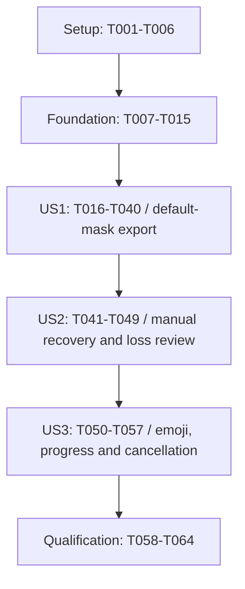

# Tasks: Local Video Privacy Mask Web Component

**Input**: Design documents in `specs/001-local-video-privacy-mask/`.

**Prerequisites**: [plan.md](plan.md), [spec.md](spec.md), [research.md](research.md), [data-model.md](data-model.md), [component contract](contracts/web-component.md), [worker protocol](contracts/worker-protocol.md), and [quickstart.md](quickstart.md).

**Delivery constraint**: Implement the entire workflow as the standard autonomous `<privacy-mask-video>` custom element, with native Shadow DOM/ES modules and no UI-framework requirement. The demo hosts that component; it is not a substitute application.

**Tests**: Included because the feature specification explicitly requires per-frame inspection, three-run tracking comparison, network inspection, edge-case fixtures, and plain-HTML/multi-instance validation (SC-001 through SC-009). Story test tasks precede the corresponding implementation and must expose meaningful failing behavior before that behavior is completed. Missing required fixtures or devices are recorded as unverified, not skipped passes. No extra TDD approval gate is introduced.

**Organization**: Setup, shared foundations, then the three stories in specification priority order, followed by cross-cutting qualification. Every task starts unchecked; generating this document does not implement or validate the application.

## User-authorized execution change (2026-10-14)

The user instructed: "lets defere testing". Testing, fixture acquisition,
calibration, runtime acceptance and performance qualification are deferred.
They remain unchecked and are not prerequisites for implementation tasks.
All test-before-code and acceptance checkpoint dependencies below are superseded
by this instruction. Follow implementation dependencies in order; retain basic
TypeScript compilation, build and asset-integrity checks. Existing test scripts
continue to fail on absent fixtures when explicitly invoked. Code portions of
mixed tasks may be implemented; their verification portions remain deferred.
Provisional tracking thresholds must be labeled uncalibrated. No test success or
privacy/coverage/performance qualification is implied by a successful build.

## Format: `[ID] [P?] [Story?] Description`

- `[P]` identifies tasks that may run concurrently with the disjoint-file peers described below after their listed dependencies are complete. It never overrides a dependency or permits simultaneous edits to shared files.
- `[US1]`, `[US2]`, and `[US3]` map to the three stories in spec.md; setup/foundation/final tasks have no story label.
- All implementation file paths are relative to the repository root. `validation/*.md` under this feature directory are future local evidence artifacts, not fabricated test results.
- Dependencies on earlier task IDs are explicit. Phase checkpoints also apply; no story implementation starts before the foundation is complete.
- The constitution is an unfilled template, so its sample principles impose no additional workflow. No extension hooks are configured.

## Path Conventions

One component library: `src/element/`, `src/core/`, `src/worker/`, `src/media/`, `src/vision/`, and `src/render/`; bundled resources in `assets/`; framework-free hosts in `demo/`; validation in `tests/`; generated distribution in `dist/`. No server project is created.

## Phase 1: Setup (Shared Infrastructure)

**Purpose**: Create the component-library toolchain, pinned local assets, and fixture infrastructure. No application implementation exists yet.

- [X] T001 Initialize `package.json`, `package-lock.json`, `tsconfig.json`, and `.gitignore` for Node 24, strict TypeScript/ES2022, Mediabunny, ONNX Runtime WASM, Vite, Vitest, and Playwright; pin resolved versions and declare the exact script names from `specs/001-local-video-privacy-mask/quickstart.md`, with no UI-framework dependency.

- [X] T002 [P] Configure `vite.config.ts` to produce `dist/index.js`, `dist/define.js`, `dist/index.d.ts`, a self-contained module worker, and copied assets/notices/demo files; preserve nested-path imports and prevent network-loaded worker chunks. (Depends on T001.)

- [X] T003 [P] Configure `vitest.config.ts` and `playwright.config.ts` for pure tests and real-browser tests against the compiled static host; separate browser/privacy/performance projects, fail on missing required fixtures, and avoid treating mocked inference as acceptance evidence. (Depends on T001.)

- [X] T004 [P] Create `assets/manifest.json`, `scripts/prepare-assets.mjs`, `scripts/verify-assets.mjs`, and `THIRD_PARTY_NOTICES.txt`; acquire immutable YuNet 2023mar/SFace 2021dec, matching ONNX JS/WASM companion modules, Noto font and supported-sequence data into `assets/models/`, `assets/runtime/`, and `assets/emoji/`; record exact revisions, SHA-256, tensor shapes, sizes and notices, reject mismatch, and never use floating runtime URLs. (Depends on T001.)

- [ ] T005 [DEFERRED] [P] Create `tests/fixtures/manifest.json`, `tests/fixtures/calibration/README.md`, and `tests/fixtures/acceptance/README.md`; acquire or generate consented/licensed local fixtures for multi-face motion/scale/tilt/crossing, no initial detection, occlusion/re-entry, manual tracking, MP4/WebM, portrait/VFR/B-frames, audio offsets/multiple tracks/silence, corruption/limits and the 60-second 720p benchmark; store hashes, provenance, face/identity/time annotations, and separate calibration from held-out acceptance. Missing real face clips remain an explicit incomplete task, never a mocked substitute. (Depends on T001.)

- [X] T006 Implement `scripts/serve-dist.mjs` for localhost:4173 static distribution serving with correct module/WASM/font/media MIME types, root and nested paths, and no framework or COOP/COEP dependency; wire its lifecycle to `playwright.config.ts` without exposing a user-visible background window. (Depends on T002, T003.)

**Checkpoint**: Tooling, asset provenance, fixture corpus and static-host infrastructure are defined and available; source-entry build execution follows foundational bootstrap.

---

## Phase 2: Foundational (Blocking Prerequisites)

**Purpose**: Establish shared types, lifecycle, privacy boundaries, and a real initialized custom-element shell.

**Gate**: Complete Phase 1 and this phase before story implementation. Domain work below uses these shared interfaces; initialization must load actual assets and must not claim that a stub pipeline processes media.

- [X] T007 Define geometry/time primitives and validators in `src/core/types.ts` and `src/core/geometry.ts`: `Rect = { x, y, width, height }` “uses finite display-oriented source pixels”; “Manual rectangles must be nonempty and fully within the displayed source bounds”; “Rotation is finite radians, clockwise in canvas coordinates, with zero upright”; “Missing landmarks are null, not invented points”; internal `timestampUs`/`durationUs` “are safe integer microseconds”. Include Point and the display-to-CSS coordinate boundary. (Depends on T006, T004, T005.)

- [X] T008 [P] Define ComponentConfiguration and ResourceLimits in `src/core/configuration.ts` and `src/core/limits.ts`: emoji “One canonical supported sequence from the shipped manifest; default U+1F60E. Invalid input preserves previous value”; disabled “Prevents new user actions and load/process/selection; cancel/reset remain available. Does not implicitly cancel existing processing”; assetBase “Same-origin directory for fixed model/runtime/font assets; default relative to the module. Set only before first connection”; limits “Internal versioned input/output/dimensions/duration caps from plan; not mutable host configuration in v1”. Enforce 256 MiB input/output each, 10 minutes, 1920 maximum per displayed dimension and 2,073,600 displayed pixels. (Depends on T007.)

- [X] T009 [P] Implement typed sanitized errors in `src/core/errors.ts` for every stable code in `specs/001-local-video-privacy-mask/contracts/web-component.md`; distinguish AbortError from failure, omit filenames/private payloads/stacks from events, and represent no-face/ordinary loss as workflow states. (Depends on T007.)

- [X] T010 [P] Define validated discriminated messages in `src/worker/protocol.ts` for INIT/LOAD/RUN/PREVIEW_ACK/CANCEL/RESET/DISPOSE and READY/LOADED/PROGRESS/PREVIEW/TRACKING/COMPLETE/CANCELED/ERROR with protocolVersion 1, instanceId, generation and jobId; specify bitmap/File/Blob ownership without embeddings in public events. (Depends on T007.)

- [X] T011 Implement ProcessingSession and transitions in `src/core/session.ts`: states are “`disconnected`, `initializing`, `empty`, `loading`, `selecting`, `selected`, `processing`, `finalizing`, `complete`, `error`”; generation is “monotonically increasing”; “Every asynchronous response must match the active generation/job before it can mutate UI or resolve a promise”. Follow every state-table transition in `specs/001-local-video-privacy-mask/data-model.md`, retain configuration on reset, and ensure “All public snapshots are defensive/read-only views, never live mutable internal objects”. (Depends on T008, T009, T010.)

- [X] T012 Implement `src/core/assets.ts` to verify and load all fixed same-origin assets before readiness, retain immutable worker/runtime/model bytes for offline restarts, create and own Blob module/runtime URLs with no unresolved chunks, load the bundled font, reject cross-origin/media-derived URLs, and release all instance-owned resources on disconnect. (Depends on T008, T009, T010.)

- [X] T013 Implement `src/core/capabilities.ts` to probe secure-context custom-element/worker/OffscreenCanvas/WASM/WebCodecs/font capabilities and expose typed general support plus per-config probe helpers; report unsupported environments without remote fallback or an unconditional browser-name guarantee. (Depends on T008, T009.)

- [ ] T014 [CODE COMPLETE; VALIDATION DEFERRED] Implement INIT/READY/ERROR/DISPOSE in `src/worker/pipeline.worker.ts` and the instance-owned channel in `src/core/worker-client.ts`; instantiate actual single-thread CPU/WASM ONNX sessions from resident matching module/binary/model resources, validate model tensor signatures, correlate replies, and close stale transferables. Exercise initialization and restart offline with the pinned runtime rather than relying on HTTP cache. (Depends on T011, T012, T013.)

- [ ] T015 [CODE COMPLETE; VALIDATION DEFERRED] Create `src/element/privacy-mask-video.ts`, `src/index.ts`, and `src/define.ts` as native HTMLElement/open-Shadow-DOM ESM entries; implement explicit/idempotent same-constructor registration and conflicting-tag errors, constructor/connection/disconnection ownership, initialize(), configuration reflection/pre-upgrade property replay, read-only snapshots, and sanitized lifecycle events. Build and smoke-check actual readiness with `npm run typecheck` and `npm run build`; media workflow methods are completed in US1. (Depends on T014.)

**Checkpoint**: The native element registers, initializes actual local assets/worker, reports capabilities, and releases instance resources. Story work can now start.

---

## Phase 3: User Story 1 — Mask and download a selected face privately (Priority: P1) — MVP

**Goal**: A plain HTML host imports the standard component, lets the user choose one detected face, and downloads a locally processed video using the default emoji.

**Independent test**: Import supported MP4 and WebM multi-face fixtures, explicitly select the intended face, process/download, independently decode every output frame and play the result, compare three repeated tracking runs, and verify no media egress. US1 already needs conservative rejection and basic visible loss handling; US2 adds full manual recovery/reacquisition and timed review.

### Tests

- [ ] T016 [DEFERRED] [P] [US1] Author `tests/contract/component-import-export.spec.ts` for registration/upgrade, local File-only load, paused initial preview, explicit/stale/overlapping candidate selection, process/result/download, event ordering, unsupported input/export, and disconnect/reinsert; scope this suite to US1/default-emoji behavior and establish failing behavior before implementing the workflow. (Depends on T015.)

- [ ] T017 [DEFERRED] [P] [US1] Author `tests/contract/worker-protocol.spec.ts` for correlated messages, transfer ownership, fresh RUN tracking state, strict per-frame order, completion after flush, and stale-result rejection; demonstrate meaningful failures for the unimplemented media path rather than counting a missing import as acceptance. (Depends on T015.)

- [ ] T018 [DEFERRED] [P] [US1] Author `tests/e2e/private-export.spec.ts` and `tests/helpers/output-inspector.ts` for real MP4/WebM/portrait/VFR/audio exports, independent output decoding/playback, full face-boundary coverage and timing tolerance of one source-frame interval or 100 ms whichever is greater; use held-out annotations and assert zero identity switches/no skipped rendered frames. (Depends on T015.)

- [ ] T019 [DEFERRED] [P] [US1] Author `tests/integration/tracking-repeatability.spec.ts` and `tests/integration/vision-reference.spec.ts` to compare real YuNet preprocessing/NMS and SFace alignment/descriptors against upstream reference fixtures, and compare all target assignments/coordinates/statuses across three identical runs; never replace actual inference with detections mocked to pass. (Depends on T015.)

- [ ] T020 [DEFERRED] [P] [US1] Author `tests/e2e/offline-export.spec.ts` to capture page and worker requests from initialization, permit only fixed initial resources, then disable the network and complete default-emoji import/process/review/download with zero media egress or persistent media writes. (Depends on T015.)

### Implementation

- [X] T021 [US1] Define SourceVideo/TrackDescriptor in `src/media/types.ts`: sourceId “Opaque instance-local identifier, replaced on every load”; file “Local reference only; positive size, accepted container and limits. Never placed in DOM events”; container `'mp4' or 'webm'` “Determined by demuxing, not trusted from filename alone”; displayWidth/displayHeight “Positive normalized dimensions, within resource limits”; durationUs “Positive playable duration within limit”; timelineOriginUs “Common normalization origin for all tracks”. (Depends on T016, T017, T018, T019, T020.)

- [X] T022 [US1] Complete source/track/route fields in `src/media/types.ts`: videoTrack “Selected primary video stream and actual decode configuration. Extra video tracks are outside the single-view workflow and trigger a clear unsupported-input error”; audioTracks “Every source audio track to preserve, or empty for silent input”; initialFrameTimeUs “First valid display frame”; initialCandidates “Stable order and IDs for selection in that frame”; outputRoute “Capability-tested preservation route, chosen before processing”. Require “Input must expose usable finite timing and constant supported display dimensions”; stream packets/frames rather than store them in metadata. (Depends on T021.)

- [X] T023 [US1] Define FaceCandidate and TargetSelection in `src/vision/types.ts` with five landmarks/confidence, stable initial-frame IDs, `kind: 'detected' | 'manual'`, `candidateId: string | null`, `initialLandmarks: Point[] | null`, and finite initialRotationRad. Preserve “It references exactly one SourceVideo” and “Selecting a candidate from a stale source or an invalid manual box fails without changing the current valid selection”; keep reference embeddings private to the worker. (Depends on T022.)

- [X] T024 [US1] Define FrameTrackingResult in `src/vision/types.ts`: `status: 'acquired' | 'lost'`; reason “Null while acquired; otherwise no-candidate, ambiguous, occluded-or-out-of-frame, or weak-manual-match”; rect/rotation “Accepted geometry or held last-accepted geometry while lost”; landmarks “Landmarks measured on this frame only; null on loss or when unavailable”; `geometrySource: 'measured' | 'held'`. Link selectionId/profileHash and require “Every successfully processed frame produces exactly one result”. (Depends on T023.)

- [X] T025 [P] [US1] Implement `src/media/timeline.ts` for integer-microsecond/adapter-second conversions, presentation timestamps/durations, B-frame reordering boundaries, and VFR preservation; enforce “Use a common timeline origin across audio/video, not a separate zero for each track” and neutral output orientation after pixel normalization. (Depends on T024.)

- [X] T026 [P] [US1] Implement `src/vision/yunet.ts` against the pinned model's actual input/output tensors, fixed preprocessing, output decoding and NMS; honor “Sort accepted candidates deterministically by left/top/size and a stable final detection index; deduplicate with fixed NMS” and “IDs remain stable only for the loaded initial frame”. Detect all returned initial candidates, including overlapping selection options. (Depends on T024.)

- [ ] T027 [CODE COMPLETE; VALIDATION DEFERRED] [P] [US1] Implement `src/vision/sface.ts` with tested five-point alignment, normalization and cosine appearance comparison; retain immutable initial identity anchors with only the last two accepted geometries/times, “Keep only a bounded history”, and ensure “References are destroyed on source replacement/reset/disconnect and recreated for repeated processing”. No named identity lookup. (Depends on T024.)

- [X] T028 [US1] Implement `src/media/input.ts` using local BlobSource MP4/WebM demuxing, actual decoder configuration checks, finite metadata validation, oriented first-frame decode, and sequential CanvasSink samples; respect resource caps, reject extra video tracks/invalid or changing dimensions, and release decoder/canvas resources on every exit. (Depends on T025.)

- [X] T029 [US1] Define OutputRoute and route negotiation in `src/media/output.ts` using `src/core/capabilities.ts`: prefer supported MP4/AVC+AAC, otherwise WebM/VP9-or-VP8+Opus; “Every planned track must pass compatibility/capability checks before processing” and “If no route preserves required audio/dimensions, fail before processing”. Match actual dimensions/channels/configurations, never drop tracks or resize silently. (Depends on T028.)

- [X] T030 [US1] Implement `src/media/audio.ts` for every source audio track: “Compatible audio packet copy is preferred; local transcode preserves audible content, not necessarily encoded bytes”; preserve relative offsets and decoder configuration, capability-check transcode, interleave with video and await writes to bound muxer buffering. (Depends on T029.)

- [ ] T031 [CODE COMPLETE; VALIDATION DEFERRED] [US1] Implement `src/vision/profile.ts` with model/runtime hashes, fixed preprocessing/NMS/motion/scale/cosine/margin parameters and immutable profile version; “Calibration produces concrete numeric constants before acceptance testing; changing any constant changes the profile hash” and “No randomness, adaptive wall-clock thresholds, or frame skipping”. Calibrate on `tests/fixtures/calibration/`, freeze numeric constants and record provenance in `tests/fixtures/calibration/profile-results.json` before held-out testing. (Depends on T026, T027.)

- [X] T032 [US1] Implement `src/vision/association.ts` for per-frame detection plus motion/scale/landmark/appearance gates, frozen identity reference, absolute threshold and runner-up margin; ambiguous/equal candidates become lost, never silently switch identity, and basic loss holds the last accepted geometry with null current landmarks. Reacquisition extensions belong to US2. (Depends on T031.)

- [X] T033 [US1] Implement default-emoji rasterization in `src/element/emoji.ts` and MaskSettings/rendering in `src/render/mask.ts`: “The bundled font and sequence manifest must be ready before rasterization”; “The backing's opaque circle radius is at least half the current face-box diagonal plus padding”; “One immutable settings snapshot belongs to a run”. Center/scale/rotate the emoji, clip at source edges, and use the same opaque backing/bitmap in preview and export. (Depends on T024.)

- [X] T034 [US1] Complete `src/media/output.ts` with awaited timestamped CanvasSource submission, output-cap enforcement during writes/finalization, codec/muxer flush, complete Blob and ExportResult metadata including safe filename/media type/extension, dimensions/timing/frame count/audio count/source/settings revision/lost intervals. Enforce “It exists only after encoder flush and muxer finalization succeed” and “It does not claim verified coverage merely because the file was created”. (Depends on T030, T033.)

- [X] T035 [US1] Implement LOAD/RUN/COMPLETE in `src/worker/pipeline.worker.ts`: preflight output on load, detect initial candidates, restart every run at the first valid frame, initialize selected-face appearance, sequentially track/render/encode every frame, interleave audio, and expose basic acquired/lost status. Integrate `src/media/input.ts`, `src/media/output.ts`, `src/vision/association.ts`, and `src/render/mask.ts`; no MediaRecorder or wall-clock frame skipping. (Depends on T034, T032.)

- [X] T036 [US1] Implement `src/element/selection.ts` and initial controls in `src/element/template.ts` for paused oriented preview, picker/drop, clickable face boxes, keyboard list including overlapping faces, CSS/letterbox-to-source mapping, and exactly one explicitly selected target. Keep processing unavailable before selection; show no-face guidance pending US2 manual recovery. (Depends on T035.)

- [X] T037 [US1] Implement load(), selectFace(), process(), result/source/faces snapshots, review playback and download() in `src/element/privacy-mask-video.ts`; await initialization, invalidate accepted replacement requests, obey disabled/state/event ordering, sanitize text/filename, retain original audio with visible unchanged-audio notice, and revoke owned URLs on invalidation/disconnect. “The Blob is retrieved through the result property or process return value”; host-retained Blobs remain host-owned. (Depends on T036.)

- [X] T038 [US1] Wire a basic text loss indicator and completed-video warning in `src/element/template.ts` and `src/element/privacy-mask-video.ts` so US1 never presents held coordinates as confirmed coverage; store loss summaries with the result for the timed review controls implemented in US2. (Depends on T037.)

- [X] T039 [US1] Create `demo/index.html` using only the distributed native element and local ES-module import; finish `src/element/styles.css` for usable responsive default controls, :host block/[hidden], documented CSS properties/parts, text statuses, and native buttons that do not submit host forms. Ensure `vite.config.ts` copies the same host to dist without separate app logic. (Depends on T038.)

- [ ] T040 [DEFERRED] [US1] Run the US1 contract/integration/export/repeatability/offline suites against `demo/index.html` and fix relevant source failures; record actual commands, hashes, codec environment and independent frame/audio/timing results in `specs/001-local-video-privacy-mask/validation/us1.md`. Missing assets/fixtures or failed corpus coverage remain incomplete rather than skipped success. (Depends on T039, T016, T017, T018, T019, T020.)

**Checkpoint**: US1 acceptance evidence is recorded and its corresponding tests pass; unresolved failures keep this phase incomplete.

---

## Phase 4: User Story 2 — Recover from missing or lost faces (Priority: P1)

**Goal**: Support manual initial selection, conservative reacquisition, and timed loss review without changing the selected identity.

**Independent test**: On the completed US1 component, use no-detection, manual-motion, crossing, occlusion and exit/re-entry clips; validate manual box input, held geometry, visible loss intervals, unique reacquisition and no silent identity switches. This story is independent of US3 customization, but intentionally builds on the US1 media pipeline.

### Tests

- [ ] T041 [DEFERRED] [P] [US2] Author `tests/contract/manual-selection.spec.ts` for selectRegion(), pointer/numeric rectangle parity, finite/nonzero/in-bounds constraints, no-face replacement flow, stale selection rejection, and preservation of valid selection after invalid input; establish failing recovery behavior before implementation. (Depends on T040.)

- [ ] T042 [DEFERRED] [P] [US2] Author `tests/integration/recovery.spec.ts` and `tests/e2e/loss-review.spec.ts` using real occlusion/re-entry/crossing/manual fixtures to assert held versus measured geometry, null lost landmarks, interval boundaries, conservative unique reacquisition and persistent ambiguity; no appearance anchor means no invented global identity recovery. (Depends on T040.)

### Implementation

- [ ] T043 [CODE COMPLETE; VALIDATION DEFERRED] [US2] Define/coalesce LossInterval in `src/vision/loss.ts`: “with start inclusive/end exclusive; the final interval ends at the last affected frame's end time”; preserve reason enums from FrameTrackingResult, merge contiguous losses, retain compact typed records and “never raw per-frame images”. Include focused interval boundary assertions in `tests/unit/loss.test.ts`. (Depends on T041, T042.)

- [X] T044 [P] [US2] Implement `src/vision/region-tracker.ts` with frozen grayscale template and deterministic bounded position/scale/roll correlation search, fixed candidate ordering and explicit weak/low-texture/ambiguous loss; “A manually selected region starts upright if landmarks are unavailable”. A uniquely agreeing detected face may supply landmarks and a frozen identity anchor, without changing the selected region's identity. (Depends on T043.)

- [X] T045 [P] [US2] Implement pointer drawing and equivalent labeled numeric fields in `src/element/selection.ts` and `src/element/template.ts`, plus selectRegion() in `src/element/privacy-mask-video.ts`; offer both manual selection and replacement after zero detections, enforce source-coordinate bounds, and preserve valid state on rejected rectangles. (Depends on T043.)

- [ ] T046 [CODE COMPLETE; VALIDATION DEFERRED] [US2] Extend `src/vision/association.ts` with full-frame appearance-based reacquisition, stricter absolute/margin gates and time-based motion widening using media timestamps; keep frozen initial reference, ambiguous matches lost, and manual-only complete-disappearance recovery conservative. Update `src/vision/profile.ts` with calibrated fixed recovery parameters and new profile hash using calibration fixtures only. (Depends on T044.)

- [X] T047 [US2] Integrate manual targets, per-frame attempted reacquisition, acquired/lost TRACKING transitions, and exact intervals in `src/worker/pipeline.worker.ts`; use measured landmarks only on acquired frames and hold last accepted geometry while lost; populate ExportResult loss metadata even when export succeeds. (Depends on T045, T046.)

- [X] T048 [US2] Add timed loss-interval list and seeking into the completed local review video in `src/element/template.ts` and `src/element/privacy-mask-video.ts`; explain held-position coverage uncertainty and distinguish file completion from face-coverage verification, with keyboard-accessible time controls and text status. (Depends on T047.)

- [ ] T049 [DEFERRED] [US2] Run manual/recovery/loss-review tests plus affected US1 tracking/export regressions; verify three-run equality with the updated profile and no identity switches on held-out clips; fix defects and record results/profile hashes in `specs/001-local-video-privacy-mask/validation/us2.md`. (Depends on T048.)

**Checkpoint**: US2 acceptance evidence is recorded and its corresponding tests pass; unresolved failures keep this phase incomplete.

---

## Phase 5: User Story 3 — Choose an emoji and inspect progress (Priority: P2)

**Goal**: Add preset/custom emoji controls, masked progress frames, responsive cancellation, and safe retry/settings changes.

**Independent test**: With US1/US2 available, apply preset/custom/invalid emoji values, compare preview/export, observe progress, cancel during load/inference/finalization, retry offline after forced worker termination, and verify no stale results or partial downloads.

### Tests

- [ ] T050 [DEFERRED] [P] [US3] Author `tests/contract/emoji-progress.spec.ts` for reflected emoji/disabled properties, valid/invalid changes, progress/tracking/complete event ordering and result invalidation; add nontrivial geometry/transparent-glyph assertions in `tests/unit/mask.test.ts`. (Depends on T049.)

- [ ] T051 [DEFERRED] [P] [US3] Author `tests/contract/cancellation.spec.ts` and `tests/e2e/offline-retry.spec.ts` for cancel/reset/replacement/settings races, duplicate process rejection, late transferred bitmap disposal, immediate AbortError, worker termination after 250 ms without acknowledgement, offline restart without HTTP cache, and no successful partial result. (Depends on T049.)

### Implementation

- [X] T052 [P] [US3] Complete `src/element/emoji.ts` with canonical single-sequence validation against the bundled manifest, presets/custom input rasterization from the resident font, and reflected-setting error handling; “A valid setting change invalidates the old result; invalid input does not”. Retain previous valid value/bitmap/result on invalid input and perform no network request when the emoji changes. (Depends on T050, T051.)

- [X] T053 [P] [US3] Implement `src/render/preview.ts` to send only masked processing ImageBitmaps at at most 5 Hz with one outstanding ACK, while progress metadata updates at least once per second while advancing; keep full per-frame tracking/export independent of preview throttling and close consumed/stale bitmaps. (Depends on T050, T051.)

- [X] T054 [US3] Complete cancellation/reset/replacement behavior in `src/core/session.ts` and `src/core/worker-client.ts`: acknowledge and invalidate immediately, settle active promises with AbortError once, keep source/selection after processing cancellation, clear canceled loads, make idle cancel a no-op, and terminate an unresponsive worker after 250 ms. Recreate workers solely from retained verified resources while connected. (Depends on T052, T053.)

- [X] T055 [US3] Implement PREVIEW_ACK/CANCEL/RESET plus cooperative cleanup in `src/worker/pipeline.worker.ts`; bind generation/job checks around asynchronous codec completion, integrate masked preview/progress/tracking messages, and release frame/codec/template/identity resources on cancellation or reset without losing immutable offline assets. (Depends on T054.)

- [X] T056 [US3] Add preset/custom emoji input, processing progress, current tracking status, cancel/reset controls and throttled live-region announcements in `src/element/template.ts` and `src/element/privacy-mask-video.ts`; integrate current snapshot bitmap, keep cancel/reset enabled under disabled, and invalidate results on valid target/emoji changes with precise public-event ordering. (Depends on T055.)

- [ ] T057 [DEFERRED] [US3] Run emoji/coverage/progress/cancellation/offline-retry suites and affected import/export/recovery regressions; verify preview/export agreement and responsive user acknowledgement, fix defects, and record actual results in `specs/001-local-video-privacy-mask/validation/us3.md`. (Depends on T056.)

**Checkpoint**: US3 acceptance evidence is recorded and its corresponding tests pass; unresolved failures keep this phase incomplete.

---

## Phase 6: Polish & Cross-Cutting Concerns

**Purpose**: Qualify the complete standard Web Component and package its documented interface. Complete all story checkpoints first; these tasks do not authorize package publication or website deployment.

- [ ] T058 [CODE COMPLETE; VALIDATION DEFERRED] [P] Create `demo/embed.html` and `tests/e2e/embedding.spec.ts` covering two independent local videos/workers, pre-upgrade properties, duplicate/conflicting registration, root/nested distribution paths, disabled/hidden/parts/CSS isolation, no enclosing-form submission, disconnect/reinsert and repeated resource-disposal cycles; repair lifecycle/API integration failures in `src/element/privacy-mask-video.ts` without shared mutable media state (template/style changes are owned by the accessibility task). (Depends on T057.)

- [ ] T059 [DEFERRED] [P] Complete keyboard/focus/label/live-region review and responsive layout checks in `tests/e2e/accessibility.spec.ts`, `src/element/styles.css`, and `src/element/template.ts`; cover import, overlapping face list, manual rectangle form, emoji, cancel, interval review and download using text feedback rather than color alone. (Depends on T057.)

- [ ] T060 [DEFERRED] Extend `tests/e2e/privacy.spec.ts` to cover page/worker initialization allowlists, all media operations after ready, forced offline worker restart, both initialized instances, sanitized events/logs, and absence of media in persistent browser storage; fix any actual egress/cache/persistence defect in `src/core/assets.ts` or `src/core/worker-client.ts` and record the audit in `specs/001-local-video-privacy-mask/validation/privacy.md`. (Depends on T058, T059.)

- [ ] T061 [DEFERRED] Implement/run `tests/e2e/performance.spec.ts` on the nominated i5-8250U/8 GiB/Windows 11 reference or a documented equivalent; measure the 60-second 720p/30fps run, advancing progress gaps, sub-one-second cancel acknowledgement, memory/queue bounds and no unresponsive prompt; write exact hardware/browser/codec/profile evidence to `specs/001-local-video-privacy-mask/validation/performance.md`. If no qualifying device is available, record unverified and leave this task unchecked; do not weaken the baseline or claim a pass on the current lower-spec host. (Depends on T060.)

- [X] T062 [P] Finalize `README.md`, `src/index.ts` public type exports and `specs/001-local-video-privacy-mask/quickstart.md` with actual script behavior, framework-free embedding/API/events, same-origin/Blob-worker/WASM/font/CSP requirements, supported codecs/resource limits, unchanged audio, loss/manual limitations and Blob ownership; reconcile documented paths with the built distribution without publishing. (Depends on T060.)

- [ ] T063 [CODE COMPLETE; VALIDATION DEFERRED] Run `npm run assets:verify`, `npm run typecheck`, `npm test`, `npm run build`, and the compiled browser/privacy/performance suites as appropriate; inspect generated `dist/index.js`, `dist/define.js`, `dist/index.d.ts`, worker/assets and `dist/THIRD_PARTY_NOTICES.txt` for missing files, unresolved chunks, external URLs and framework dependencies. Avoid repeating successful unchanged checks; record outstanding runtime limits truthfully in `specs/001-local-video-privacy-mask/validation/final.md`. (Depends on T062.)

- [X] T064 Complete the requirement-to-evidence report in `specs/001-local-video-privacy-mask/validation/final.md` for FR-001 through FR-013, NFR-001 through NFR-004 and SC-001 through SC-009; update completion markers in `specs/001-local-video-privacy-mask/tasks.md` only for work actually implemented and verified, keeping unresolved fixture/device/coverage failures explicit. (Depends on T063, T061.)

**Checkpoint**: Complete feature qualification is supported by actual evidence. Unavailable performance hardware or failed privacy/coverage checks remain explicit incomplete tasks.

---

## Dependencies & Execution Order

### Phase and story graph

US2 intentionally depends on the completed US1 decoder/tracker/export/UI; US3 builds on both so cancellation and settings invalidation cover all target types. These are honest workflow dependencies, not three independent applications. Each completed story has a runnable acceptance increment. Do not attempt whole-story concurrent edits to `src/element/privacy-mask-video.ts` or `src/worker/pipeline.worker.ts`.

### Within a phase

Complete declared prerequisites first. Author story tests before behavior implementation, establish meaningful failures, build models before services, integrate the worker before the element workflow, then run the story acceptance checkpoint. A task that calibrates a profile must finish before evaluating held-out acceptance clips with that profile. Do not modify the acceptance corpus to conceal tracking failures.

Performance qualification may require another qualifying machine. The documentation task depends on the privacy audit rather than the performance result so useful packaging/documentation can proceed. Final completion still depends on actual performance evidence; a below-baseline run does not close that task.

### Parallel opportunities

| Wave | Tasks | Ready when | Separation |
| --- | --- | --- | --- |
| Setup | T002, T003, T004, T005 | T001 | Build config, test config, pinned asset scripts, fixture corpus |
| Shared contracts | T008, T009, T010 | T007 | Configuration/limits, sanitized errors, protocol types |
| US1 acceptance definitions | T016, T017, T018, T019, T020 | T015 | Separate component, worker, export, inference, and privacy test files |
| US1 media/vision adapters | T025, T026, T027 | T024 | Timeline, detector, appearance modules |
| US2 tests | T041, T042 | T040 | Manual API and recovery/review scenarios |
| US2 core/UI | T044, T045 | T043 | Region tracker versus manual selection controls |
| US3 tests | T050, T051 | T049 | Emoji/progress versus cancellation/restart scenarios |
| US3 rendering | T052, T053 | T050, T051 | Emoji rasterization versus worker-preview queue |
| Qualification | T058, T059 | T057 | Embedding/lifecycle API versus accessibility template/styles |
| Documentation alongside measurement | T062 alongside T061 | T060 | README/API declarations/quickstart versus performance test/evidence |

No delegation is required to execute this plan. Parallel markers describe scheduling opportunities, not permission to launch agents or edit shared files concurrently.

## Parallel Example: User Story 1

After T024, implement T025 in `src/media/timeline.ts`, T026 in `src/vision/yunet.ts`, and T027 in `src/vision/sface.ts` concurrently. Join before the dependent input/profile/association work. All test-definition tasks T016, T017, T018, T019, T020 can also be authored together after foundation readiness.

## Parallel Example: User Story 2

After T043, implement T044 in `src/vision/region-tracker.ts` and T045 in the element selection/template/API files concurrently. Do not start the shared worker integration T047 until both manual UI and reacquisition dependencies are complete.

## Parallel Example: User Story 3

After the two test-definition tasks, implement T052 in `src/element/emoji.ts` and T053 in `src/render/preview.ts` concurrently. Join before cancellation/worker integration and the shared UI task; those later edits are sequential.

## Requirement Coverage

| Requirement | Implement / verify |
| --- | --- |
| FR-001/002: local import and initial frame | T021, T022, T028, T036, T037, T016, T018 |
| FR-003: explicit face selection | T023, T026, T036, T037, T016 |
| FR-004: deterministic tracking | T024, T026, T027, T031, T032, T035, T019, T040, T049 |
| FR-005: positioned/scaled/rotated coverage | T033, T018, T050, T057 |
| FR-006: local playable export | T025, T029, T030, T034, T035, T037, T018, T040 |
| FR-007/008: manual fallback/loss | T041, T042, T043, T044, T045, T046, T047, T048, T049 |
| FR-009/010: emoji and progress | T050, T052, T053, T055, T056, T057 |
| FR-011: cancellation/replacement | T011, T051, T054, T055, T056, T057 |
| FR-012: review and coverage status | T038, T048, T042, T049 |
| FR-013: standard Web Component | T002, T015, T016, T037, T039, T058, T062, T063 |
| NFR-001/004; SC-004: privacy/local lifetime | T012, T014, T020, T051, T058, T060 |
| NFR-002/003; SC-006: responsiveness/usability | T053, T054, T056, T059, T061 |
| SC-001/002/003/005: complete pipeline and correct output | T018, T019, T040, T049 |
| SC-007/008/009: recovery/customization/embedding | T049, T057, T058, T063 |

## Implementation Strategy

### MVP First

Complete Setup, Foundation, and US1 (T001 through T040) for a demonstrable native element that masks an explicitly selected detected face with the default emoji and exports privately. US1 includes conservative loss indication: it must never falsely claim that a held mask proves coverage. This MVP is an incremental demonstration, not completion of all P1 scope; US2 is also P1 and is required for missing-face recovery and timed loss review.

### Incremental Delivery

1. Run the US1 checkpoint on actual media and real inference before building on the pipeline.
2. Add US2 manual-region tracking, conservative reacquisition, and timed loss review; rerun affected tracking/export checks.
3. Add US3 emoji controls, masked progress, cancel/reset/race protection, and forced-termination offline retry.
4. Qualify the compiled component in plain HTML, multiple instances, nested hosting, keyboard use, offline operation, and the documented performance environment.
5. Finish documentation/package inspection and evidence-based requirement reporting. No publication or deployment is part of these tasks.

## Notes

- Mark tasks complete only after their stated work and verification actually succeed; generation leaves all 64 unchecked.
- Shared entity constraints are quoted from data-model.md in the owning tasks. The referenced model/contract remains authoritative for all fields, transitions, events, ownership, and error codes.
- Do not transmit private fixtures or user video to obtain a passing test or attach identifying images/logs to an external service.
- Run appropriate checks once per unchanged input; repeat after new failures or changes, not as a substitute for completing implementation.
- Do not turn the unset constitution, documentation checkpoints, or optional parallel scheduling into new approval gates.
